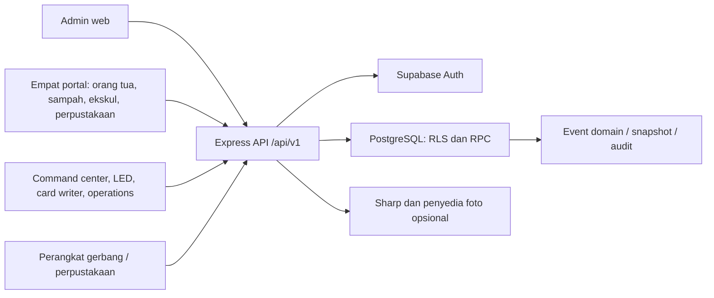

# Laporan Awal Analisis Aplikasi AKSIS

Tanggal: 30 Oktober 2026 (WITA)  
Versi aplikasi: `0.3.0` — commit acuan: `8f6b6bf`  
Objek: source code dalam workspace AKSIS.CO.ID  
Status: penilaian awal berbasis kode dan pengujian lokal, bukan sertifikasi keamanan produksi.

## 1. Kesimpulan eksekutif

AKSIS merupakan platform operasional sekolah multitenant yang menghubungkan identitas siswa, produksi kartu, presensi, Bank Sampah, perpustakaan, ekstrakurikuler, dan pemantauan orang tua. Implementasinya sudah melampaui prototipe tampilan: tersedia API, migrasi database, otorisasi, pencatatan transaksi, sinkronisasi perangkat, dan pengujian otomatis.

Fondasi teknis cukup baik: TypeScript, validasi Zod, middleware autentikasi dan sekolah, PostgreSQL RLS, RPC transaksional, serta pemisahan kredensial perangkat. Seluruh 150 tes pada 28 berkas lulus dan build sembilan aplikasi web berhasil.

Namun, hasil tersebut belum cukup untuk menyatakan sistem siap diperluas di produksi. Risiko terbesar berada pada identitas orang tua yang memakai akun QR bersama, otorisasi database yang tidak konsisten dengan isolasi perangkat, penerimaan foto tanpa validasi ketat, dan reset password. Integritas laporan juga perlu dibenahi sebelum dipakai sebagai dasar keputusan sekolah.

Rekomendasi: dahulukan pengamanan akses data siswa dan kontrak database, lalu perbaiki akurasi laporan dan kelengkapan deployment. Pengembangan fitur baru sebaiknya mengikuti stabilisasi bagian tersebut.

## 2. Lingkup, metode, dan batas bukti

Analisis mencakup struktur repository, konfigurasi dependensi, sembilan frontend, komposisi API, middleware, rute penting, migrasi SQL, RLS/RPC orang tua, produksi kartu, pengolahan foto, offline queue, konfigurasi hosting, dokumentasi, dan pengujian yang tersedia.

Metode:

1. Inventaris berkas dan pembacaan kode serta dokumentasi.
2. Pelacakan alur frontend → API → RPC/tabel → kebijakan akses.
3. Instalasi dependensi sesuai lockfile dengan `npm ci --ignore-scripts`.
4. Unit/integration test Node, pemeriksaan TypeScript, build, dan audit dependensi npm.
5. Percobaan pengujian database pada PostgreSQL sementara yang dihapus sesudah tes.

Label bukti dalam laporan:

- **Terkonfirmasi kode:** perilaku atau kekurangan terlihat dalam implementasi; belum tentu telah dieksploitasi.
- **Terkonfirmasi uji:** direproduksi melalui perintah lokal pada peninjauan ini.
- **Perlu verifikasi:** bergantung konfigurasi, data, perangkat, atau lingkungan produksi.

Tidak dilakukan login menggunakan akun nyata, pengambilan data siswa produksi, perubahan database remote, deployment, pengujian serangan ke layanan aktif, uji beban, atau pengujian perangkat fisik. Klaim penerapan dalam dokumen lama tidak dianggap sebagai bukti kondisi produksi saat ini. Seluruh migrasi belum berhasil diverifikasi sampai akhir. Browser end-to-end dan audit visual/aksesibilitas belum dijalankan.

## 3. Gambaran produk dan pengguna

| Pengguna | Kebutuhan | Implementasi yang ditemukan |
| --- | --- | --- |
| Pengelola platform | Sekolah, IAM, perangkat, audit, produksi kartu | Admin web, rute `/platform`, `/platform/production` |
| Admin sekolah | Siswa, kelas, tahun ajaran, kartu, aktivitas dan laporan | Admin web dan API tenant |
| Orang tua | Menghubungkan anak, aktivitas, izin, foto | Parent PWA dan `/parent` |
| Petugas Bank Sampah | Identifikasi siswa, timbang/setoran, ringkasan kelas | Waste PWA dan `/waste` |
| Pembina/guru | Kegiatan, anggota, sesi, presensi ekskul | Extracurricular PWA dan `/extracurriculars` |
| Petugas perpustakaan | Scan kartu/nomor siswa, kunjungan, antrean offline | Library terminal dan `/library` |
| Operator perangkat | Tulis/verifikasi kartu, LED, monitor | Card writer, LED gateway, command center |
| Pengelola operasional | Ekspor data aktivitas | Operations console |

Nilai utama produk adalah satu identitas siswa untuk beberapa aktivitas sekolah dan visibilitas aktivitas bagi keluarga. Sistem ini berfokus pada administrasi dan aktivitas pendukung sekolah; belum ada dasar untuk menyebutnya sistem akademik lengkap, LMS, atau sistem keuangan sekolah.

## 4. Arsitektur dan inventaris teknis

| Bagian | Teknologi dan karakteristik |
| --- | --- |
| Backend | Node.js ≥20, Express 5, TypeScript strict, Zod, Pino |
| Frontend | TypeScript dan DOM langsung, Vite, HTML/CSS; tanpa framework UI utama |
| Data/auth | Supabase JS, PostgreSQL, Auth, RLS, fungsi `SECURITY DEFINER` |
| Identifikasi | QR, UID kartu, NISN/nomor siswa; Web Serial untuk station |
| Pengolahan foto | Sharp; Photoroom/Clipdrop opsional berdasarkan env |
| Testing | Vitest, Supertest, tes SQL, skrip browser berbasis Puppeteer |
| Hosting acuan | Vercel static frontend + Express serverless melalui `api/index.ts` |
| Migrasi | 73 berkas SQL, dari fondasi September hingga optimasi Oktober 2026 |

Repository menggunakan satu `package.json` dan satu lockfile untuk seluruh aplikasi. Struktur direktori sudah memisahkan frontend, backend, shared code, database, tooling, dan dokumentasi, tetapi belum memakai batas paket/workspace yang tegas.

### Kematangan masing-masing aplikasi

| Aplikasi | Penilaian awal |
| --- | --- |
| `admin-web` | Modul paling luas: data sekolah/siswa, impor Dapodik/Excel, kelas, dashboard, kartu, laporan, dan platform management |
| `parent-pwa` | UI cukup luas; linking, aktivitas, izin, foto. Kontrak ringkasan dan batas akses perlu prioritas tinggi |
| `waste-pwa` | Operasional scan dan transaksi tersedia; ada tes perhitungan serta pembaca dashboard dengan pagination |
| `extracurricular-pwa` | Aktivitas dan presensi tersedia; perlu validasi alur lengkap dengan database terbaru |
| `library-terminal` | Scan, identifikasi, ringkasan, cache identitas, antrean offline dan sinkronisasi tersedia |
| `card-writer` | Ada simulator dan adapter serial dengan request ID, timeout, serta verifikasi; kesiapan fisik belum diuji |
| `led-gateway` | Polling, heartbeat, acknowledgement, cache/fallback tersedia; `HuiduAdapter` saat ini hanya menulis ke DOM, belum integrasi controller fisik |
| `command-center` | Snapshot, refresh 30 detik, status freshness dan fallback tersedia; provisioning/login mandiri masih minimal |
| `operations-console` | Sangat minimal: tombol ekspor dengan token/sekolah dari sessionStorage, tanpa alur login lengkap dalam modul |

Command center, LED, dan operations membaca konfigurasi/kredensial dari browser storage. Mekanisme provisioning yang nyaman bagi pengguna akhir perlu dibuktikan sebelum modul dianggap siap operasional mandiri.

## 5. Alur data dan batas kepercayaan

### Akses manusia dan sekolah

`requireAuth` memverifikasi bearer token melalui Supabase Auth. `requireTenant` memeriksa header `X-School-Id`, keanggotaan aktif, role dan permission. Sebagian besar query memakai client dengan JWT pengguna agar RLS tetap berlaku. Otoritas platform diverifikasi lagi melalui RPC `is_platform_admin`.

Ini merupakan fondasi yang baik. Namun, client service-role juga digunakan pada provisioning, pengelolaan platform, portal QR, dan sebagian resolusi perpustakaan. Dengan demikian, dokumentasi lama yang menyatakan aplikasi tidak boleh mengonfigurasi service-role sudah tidak sesuai implementasi. Semua pemakaian service-role membutuhkan pemeriksaan otorisasi dan scope yang eksplisit karena melewati RLS.

### Portal QR

Server membuat secret acak, menyimpan hash SHA-256, dan menyediakan identitas Auth untuk portal. Password identitas portal diturunkan menggunakan HMAC dengan key server. Frontend menghapus token QR dari URL dan menyimpan sesi yang dapat diperbarui. Ada pemeriksaan pencabutan portal dalam middleware dan sejumlah fungsi SQL.

Untuk orang tua, akun QR tingkat sekolah dipakai bersama beberapa keluarga. Migrasi terbaru mengganti sebagian isolasi `session_id` dengan `device_id` yang dibentuk dan dikirim browser. Perubahan ini tidak diterapkan konsisten pada semua policy dan RPC; akibatnya, batas keamanan keluarga tidak setara dengan batas sekolah yang sudah tersedia.

### Perangkat dan transaksi

Gerbang/perpustakaan/LED/card writer memiliki rute terpisah dari autentikasi manusia. Kredensial perangkat dibawa lewat skema `Device` dan ID perangkat. Tersedia pola event ID/idempotensi dan sinkronisasi; library memakai advisory lock untuk event yang sama. Pola ini membantu mencegah transaksi ganda saat retry, tetapi uji hardware dan seluruh migrasi tetap diperlukan.

### Foto siswa

Foto diterima sebagai string, diolah server, lalu disimpan pada siswa dan disalin ke snapshot kartu. Provider eksternal opsional dapat menerima foto ketika key tersedia. Jika semua pengolahan gagal, fungsi mengembalikan input mentah. Data foto juga dikonsumsi library terminal melalui rendering HTML, sehingga validasi input dan output harus dipandang sebagai satu alur.

## 6. Register temuan dan prioritas

Prioritas P0 berarti perlu ditangani sebelum perluasan penggunaan data nyata; P1 sebelum rilis stabil berikutnya; P2 peningkatan ketahanan dan pemeliharaan. Tingkat risiko merupakan penilaian awal, bukan skor hasil pentest.

| ID | Prioritas / risiko | Temuan | Bukti |
| --- | --- | --- | --- |
| F01 | P0 / Kritis | Isolasi keluarga dapat dilewati melalui jalur database yang hanya memakai akun bersama | Kode |
| F02 | P0 / Tinggi | Foto tidak tervalidasi dapat mencapai `innerHTML` terminal perpustakaan | Kode; eksekusi browser belum diuji |
| F03 | P0 / Tinggi | Penulisan izin langsung ke tabel tidak mensyaratkan hubungan anak | Kode |
| F04 | P1 / Tinggi | Linking lintas sekolah melemahkan validasi role dan identitas | Kode |
| F05 | P1 / Tinggi | Reset password memiliki nilai bawaan tetap dan fallback target terlalu luas | Kode |
| F06 | P1 / Tinggi | Kontrak ringkasan orang tua mengalami regresi pada migrasi terbaru | Kode |
| F07 | P1 / Tinggi | Agregasi/ekspor berpotensi terpotong dan menyamarkan error | Kode; skala produksi belum diuji |
| F08 | P1 / Tinggi | Lockfile dilaporkan memiliki dependensi rentan | Uji `npm audit` |
| F09 | P1 / Sedang | Pengujian database tidak dapat menyelesaikan migrasi di lingkungan lokal | Uji |
| F10 | P1 / Sedang | Paket Vercel hanya mencakup lima dari sembilan frontend | Kode dan build |
| F11 | P1 / Sedang | Cakupan audit aplikasi tidak menjangkau seluruh jalur perubahan | Kode |
| F12 | P2 / Sedang | Data/token browser dan cache tidak memiliki kebijakan siklus hidup seragam | Kode |
| F13 | P2 / Sedang | Integrasi hardware dan monitoring masih memerlukan pembuktian operasional | Kode; lingkungan belum diuji |
| F14 | P2 / Sedang | Dokumentasi, konfigurasi dan pemeliharaan repository perlu diselaraskan | Kode dan inventaris |

### F01 — Isolasi keluarga tidak konsisten

Policy `parent_links_self_select` pada `202609220004_phase_08_parent_access.sql` mengizinkan pembacaan berdasarkan `parent_user_id = auth.uid()` saja. Tidak ditemukan migrasi pengganti yang mengikat policy tersebut pada keluarga/perangkat/sesi. Karena banyak keluarga memakai identitas Auth QR yang sama, policy ini dapat membuka daftar hubungan milik pengguna lain pada akun QR itu, termasuk `device_id`.

RPC terbaru `get_parent_children(text)` dan `get_parent_child_today(uuid,text)` dalam `202610090007_restore_device_isolation.sql` memercayai parameter perangkat dari caller. ID itu berasal dari localStorage dan bukan identitas perangkat yang diverifikasi server. Pembacaan hubungan langsung melalui Supabase berpotensi menyediakan ID yang dibutuhkan untuk mengakses ringkasan keluarga lain.

Selain itu, `update_student_photo_by_parent` hanya mencocokkan user dan hubungan siswa, tanpa `device_id`, status hubungan aktif, atau pemeriksaan portal aktif di dalam fungsi. RPC izin juga hanya memeriksa hubungan berdasarkan user dan siswa. Pembatasan UI/API tidak menutup akses langsung Supabase yang diberi grant kepada `authenticated`.

**Dampak:** risiko pembacaan aktivitas dan perubahan data siswa oleh keluarga lain dalam akun QR bersama. Belum dilakukan eksploitasi pada lingkungan aktif.

**Perbaikan:** gunakan identitas orang tua individual atau identitas sesi server yang terikat pada hubungan; terapkan invariant yang sama pada seluruh policy, RPC, foto, izin dan profil. Jangan jadikan ID browser sebagai bukti otorisasi. Tambahkan tes dua keluarga pada akun QR sekolah yang sama, termasuk akses REST/RPC langsung.

### F02 — Alur foto membuka jalur injeksi HTML

`routes/parents.ts` hanya memastikan `photo_url` adalah string tidak kosong. `services/photo-processor.ts` mengembalikan string asli jika decoding/pengolahan gagal. `update_student_photo_by_parent` menerima teks tersebut dan menyimpannya.

`apps/library-terminal/src/main.ts` sekitar baris 144 dan 208 menyisipkan `photo_url` mentah ke atribut `style` dalam `innerHTML`. Pemisah kutip/markup pada input dapat mengubah struktur HTML. Terdapat jalur input → penyimpanan → HTML sink yang perlu diperbaiki sebagai risiko stored XSS; eksekusi script bergantung browser dan CSP hosting yang belum diverifikasi. CSP dari Helmet hanya melindungi respons API, sedangkan frontend disajikan sebagai aset statis Vercel.

**Perbaikan:** tolak payload foto invalid dengan 4xx; batasi MIME, ukuran byte, jumlah pixel dan hasil decode; selalu encode ulang. Gunakan elemen DOM dan properti `img.src` dengan URL yang diizinkan, hindari interpolasi HTML. Periksa hubungan anak sebelum menjalankan pekerjaan foto yang mahal. Jika key kedua provider aktif, dua timeout 45 detik berturut-turut juga berpotensi melampaui `maxDuration: 60` Vercel; gunakan batas total atau antrean pekerjaan.

### F03 — Policy izin dapat melewati validasi RPC

Migrasi `202610050001_student_absence_permits.sql` memberi `authenticated` hak select/insert/update/delete pada tabel izin. Policy `student_absence_permits_parent_all` hanya memeriksa `parent_user_id = auth.uid()`, tanpa memastikan hubungan ke siswa, kecocokan sekolah-siswa, dan kelayakan tanggal/alasan/lampiran.

Caller database langsung dapat melewati aturan RPC, termasuk aturan surat dokter dan status `APPROVED`. Kolom `school_id` serta `student_id` memakai foreign key terpisah sehingga kesesuaian keduanya juga tidak dijamin oleh pasangan FK tersebut.

**Perbaikan:** batasi write tabel dan gunakan RPC yang aman atau perketat RLS dengan hubungan dan scope sekolah. Tambahkan constraint komposit sesuai model tenant. Uji operasi langsung memakai user tanpa hubungan, hubungan nonaktif, portal dicabut, serta siswa sekolah berbeda.

### F04 — Linking lintas sekolah melemahkan kontrak

Definisi terakhir pada `202610090008_cross_school_parent_linking.sql` mencari `student_number` + tanggal lahir lintas seluruh sekolah, menggunakan `limit 1` tanpa pemilihan sekolah atau penanganan ambiguitas. Parameter disebut `p_nisn`, tetapi kolom `nisn` tidak diperiksa. Pemeriksaan `q.role_code = 'PARENT'` yang ada pada versi sebelumnya hilang; profil `p_parent_name` juga tidak diperbarui.

**Dampak:** siswa dengan NISN berbeda dari nomor lokal dapat gagal dihubungkan; nomor lokal/tanggal lahir yang sama di beberapa sekolah dapat memilih anak yang salah; akun QR selain orang tua tidak ditolak secara eksplisit di fungsi terakhir.

**Perbaikan:** tegaskan jenis identifier, validasi role, identifikasi sekolah/anak secara deterministik, dan tambahkan bukti kewenangan orang tua yang lebih kuat daripada dua atribut siswa. Beri pembatasan percobaan pada jalur database juga, karena rate limiter Express tidak mencakup akses Supabase langsung.

### F05 — Reset password terlalu mudah diprediksi dan terlalu luas

`routes/platform.ts` menyediakan reset password dengan default tetap `password123` dan mengembalikan password dalam respons. Jika mapping `SCHOOL_ADMIN` tidak ditemukan, rute reset admin mengambil seluruh anggota sekolah yang belum dihapus, lalu mencoba mereset semuanya. Query error pada pencarian target tidak dibedakan dari hasil kosong.

Rute sudah dilindungi `requireAuth` dan `requirePlatform`; temuan ini bukan endpoint reset publik. Risikonya berupa password mudah ditebak dan kesalahan operator yang berdampak ke banyak akun.

**Perbaikan:** gunakan reset link/token sekali pakai atau password acak dengan alur penggantian; hapus fallback seluruh anggota, tangani error query, catat audit dan target eksplisit.

### F06 — Dashboard orang tua kehilangan ringkasan kaya data

Migrasi `202609300001_parent_dashboard.sql` menyediakan `profile`, `attendance`, `waste`, `library`, `extracurricular`, dan `as_of`. Migrasi `202610090004` menghapus signature lama; versi akhir `202610090007` mengembalikan hanya `student_id`, `timezone`, dan `events`.

Frontend memiliki fallback sehingga halaman masih dapat tampil, tetapi total poin dan kunjungan bulanan menjadi tidak tersedia. Status izin dan jadwal ekskul tidak lagi dijamin oleh payload terbaru. Ini contoh regresi yang dapat lolos build dan tes fixture frontend.

**Perbaikan:** pertahankan kontrak ringkasan kaya data sambil memperbaiki isolasi; buat tes kontrak yang memanggil RPC hasil seluruh migrasi, bukan hanya fixture lama.

### F07 — Laporan berpotensi memberikan angka tidak lengkap

`routes/reporting.ts` pada `classes-summary` dan `class-report` membaca banyak tabel tanpa pagination menyeluruh atau agregasi SQL. Sebagian error query diabaikan dan `data ?? []` diubah menjadi angka nol. `routes/library.ts` juga menghitung ringkasan dari satu hasil query tanpa loop pagination.

Ekspor `/:domain` memakai `.limit(10000)` tanpa indikator truncation; batas hasil efektif juga bergantung konfigurasi PostgREST. Ringkasan ekskul menghitung seluruh sesi non-cancelled, sehingga periode dan sesi masa depan perlu didefinisikan. Beberapa agregasi menghitung transaksi/tap, bukan hari hadir unik.

**Perbaikan:** lakukan agregasi di database atau pagination teruji, gagal secara eksplisit bila sumber data gagal, sertakan periode/tahun ajaran dan definisi metrik. Uji lebih dari batas baris backend serta rekonsiliasi dengan transaksi sumber. Pembaca waste dashboard dan endpoint rankings sudah memiliki pola pagination yang dapat dijadikan acuan.

### F08 — Audit dependensi

Pada 30 Oktober 2026, `npm audit` untuk lockfile lokal melaporkan **11 paket rentan: 3 moderate, 6 high, 2 critical**. Ini jumlah entri paket, bukan 11 eksploitasi independen; beberapa berasal dari rantai dependensi yang sama.

| Kelompok | Paket yang dilaporkan | Implikasi awal |
| --- | --- | --- |
| Runtime/import data | `sharp`, `xlsx`, `zod`, `body-parser`, `qs` | Periksa jalur foto, file spreadsheet dan validasi request |
| Tooling/development | `vite`, `vitest`, `@vitest/mocker`, `tinypool`, `source-map-js`, `ip-address` | Petakan dependency tree dan kondisi paparan; tingkat critical tercatat pada `vitest`/`tinypool` |

Severity mengikuti registry npm saat audit, bukan bukti bahwa deployment AKSIS dapat dieksploitasi. `xlsx` tidak memiliki perbaikan yang ditawarkan melalui `npm audit`; beberapa pembaruan lain memerlukan perubahan versi mayor. Jangan menjalankan `npm audit fix --force` tanpa pengujian kompatibilitas. Bukti JSON terstruktur disertakan pada `docs/analysis/2026-10-30/npm-audit.json`.

### F09 — Pengujian migrasi lokal belum dapat diselesaikan

`bash tooling/test-parent-db-local.sh` berhenti di `202610020001_platform_iam_enhancements.sql` karena tabel stub `auth.users` tidak memiliki `last_sign_in_at`. Percobaan kedua pada salinan skrip sementara, dengan kolom itu ditambahkan hanya ke DB disposable, berhenti karena PostgreSQL lokal 14.18 tidak mengenali opsi view `security_invoker`.

Ini menunjukkan ketertinggalan harness dan ketidakcocokan versi lingkungan uji, bukan bukti SQL tersebut gagal di Supabase produksi. Tidak dilakukan penghapusan opsi keamanan untuk memaksa tes lulus.

**Perbaikan:** pin PostgreSQL yang mendukung migrasi, perbarui auth stub, lalu jalankan seluruh migrasi dan suite SQL dua sekolah/dua keluarga. Tambahkan ke CI.

### F10 — Deployment belum mencakup semua aplikasi

`vercel-build` dan rewrite Vercel hanya mengemas admin, parent, waste, extracurricular, dan library. LED, command center, card writer, serta operations dapat di-build tersendiri tetapi tidak disalin ke output deployment utama. Beberapa mendaftarkan `/sw.js` di root, sehingga penempatan pada subpath perlu penyesuaian scope/base.

**Perbaikan:** putuskan deployment domain/subpath per aplikasi, tambahkan build/rewrite/base URL serta tes route dan service worker yang sesuai. Jika keempatnya memang di-host terpisah, dokumentasikan deployment tersebut.

### F11 — Audit aplikasi belum menyeluruh

`auditTrail` dipasang setelah rute parent, platform, production, dan runtime perangkat. Akibatnya middleware ini tidak mencatat rute-rute tersebut. Sebagian RPC memiliki audit internal, tetapi kesetaraan cakupannya belum terbukti, khususnya operasi service-role langsung dan reset password.

Middleware juga mengirim append audit setelah respons selesai, tanpa menunggu ketahanan penyimpanan; lifecycle serverless berpotensi memotong pekerjaan tersebut. Before/after data dan resource ID selalu null di middleware.

**Perbaikan:** catat aksi sensitif secara transaksional dalam RPC atau mekanisme durable; definisikan matriks per aksi dan uji bukti audit, termasuk kegagalan dan reset kredensial.

### F12 — Token, profil dan cache browser

Admin menyimpan sesi di sessionStorage; portal menyimpan access/refresh token di localStorage. Terminal library menyimpan nama, kelas, foto, dan identifier hasil scan di localStorage. Command center memakai satu key snapshot tanpa scope sekolah, sehingga fallback lama berpotensi tampil setelah perubahan konfigurasi sekolah pada browser yang sama.

Service worker portal mengecualikan request API, tetapi ini tidak berarti tidak ada data siswa di browser: cache identitas library dibuat langsung oleh kode aplikasi. Diperlukan kebijakan masa simpan, penghapusan pada logout/pencabutan, dan penggunaan terminal bersama. Penyimpanan token juga memperbesar dampak injeksi script pada origin yang sama.

### F13 — Operasional/hardware belum terbukti

Adapter LED saat ini merender konten ke elemen `#screen`; belum ada pengiriman ke controller Huidu dalam adapter tersebut. Heartbeat gateway selalu melaporkan `controller_online: true`, tanpa pembacaan kondisi controller fisik. Card writer memiliki adapter serial tetapi memerlukan firmware kompatibel dan pembuktian baca/tulis fisik.

Metrics API disimpan di memori proses dengan jendela 1.000 durasi terakhir. Pada serverless/multi-instance, angka itu bukan agregat sistem. Rate limiter juga memakai penyimpanan default proses dan konfigurasi proxy perlu diverifikasi; jangan menganggapnya batas global yang tahan restart.

Dokumen production readiness sudah menyebut target availability, latency, backup, dan pemulihan, tetapi checklist masih kosong. Belum ada bukti dari peninjauan ini untuk SLO, alert aktif, PITR, restore drill atau kapasitas jam masuk sekolah.

### F14 — Pemeliharaan dan dokumentasi

- `admin-web/src/app.ts` sekitar 2.777 baris dan parent `main.ts` sekitar 1.509 baris memusatkan banyak state, HTML dan event handler; perubahan lintas fitur menjadi lebih berisiko.
- Beberapa modul inti/minor ditulis padat dalam satu baris, menyulitkan review dan pelacakan error.
- `npm run build` hanya membangun API. `typecheck:portals` tidak mencakup empat frontend tambahan. Pemeriksaan penuh perlu satu perintah yang jelas.
- README API masih melarang service-role padahal aplikasi kini memerlukannya pada beberapa alur.
- `.env.example` menggunakan CORS localhost:5173, sedangkan admin Vite memakai 4173 dan portal port lain; same-origin proxy dapat menutup masalah ini saat dev, tetapi konfigurasi lintas origin harus diselaraskan.
- Ada berkas akun akses yang terlacak Git dengan label password. Nilai tidak disalin ke laporan dan validitasnya tidak diuji. Tinjau apakah data tersebut kredensial aktif; jika aktif, pindahkan ke penyimpanan secret dan rotasi kredensial terkait.
- Banyak skrip ad hoc di root berpotensi menyentuh proyek remote; jangan menjalankan semua berkas `test*.js` sebagai suite tanpa inspeksi.
- Tidak ditemukan konfigurasi workflow `.github` yang terlacak. Proses CI eksternal mungkin ada, tetapi belum terverifikasi.

## 7. Hasil pengujian peninjauan ini

| Pemeriksaan | Hasil | Batas interpretasi |
| --- | --- | --- |
| `npm ci --ignore-scripts` | Lulus, 241 paket dipasang | Lifecycle scripts tidak dijalankan |
| `npm test` | Lulus: 28 berkas, 150 tes | Banyak pengujian schema/mock; bukan pembuktian seluruh RLS atau UI |
| `npm run typecheck:portals` | Lulus: API dan lima frontend utama | Empat frontend lain diperiksa terpisah |
| Typecheck empat frontend tambahan | Lulus: LED, command center, card writer, operations | Menggunakan tsconfig masing-masing |
| `npm run build` | Lulus: kompilasi API | Belum membuktikan startup dengan konfigurasi produksi |
| `npm run vercel-build` | Lulus: lima frontend dan output gabungan | Tidak mencakup empat aplikasi tambahan |
| Build LED, command, card-writer, operations | Seluruhnya lulus | Belum membuktikan provisioning/hardware |
| `npm audit --json` | 11 paket rentan | Keterpaparan tiap advisory perlu ditriase |
| SQL parent pada DB disposable | Terhenti: auth stub tidak lengkap | Belum mencapai assertion parent |
| SQL parent dengan stub sementara diperbarui | Terhenti: PostgreSQL 14 tidak mendukung `security_invoker` | Seluruh migrasi belum diverifikasi |
| Browser end-to-end, pentest, load test | Belum dijalankan | Tidak boleh dianggap lulus |

Seluruh pemeriksaan TypeScript dan build backend selesai dengan exit code 0. Tidak dilakukan perubahan source implementasi untuk mengubah hasil tes.

Build admin menghasilkan chunk utama sekitar 253 kB dan `xlsx` sekitar 424 kB sebelum gzip. Portal pemindai membawa chunk sekitar 375 kB sebelum gzip. Ini bukan kegagalan build, tetapi perlu pengukuran waktu muat pada ponsel dan jaringan sekolah; lazy loading scanner/impor dapat dipertimbangkan setelah risiko utama selesai.

## 8. Rencana tindak lanjut

| Tahap | Pekerjaan | Kriteria selesai |
| --- | --- | --- |
| P0: proteksi data | Benahi F01–F03; batasi jalur foto, izin dan direct database; tinjau akun akses | Tes negatif dua keluarga dan dua sekolah lulus melalui API serta Supabase langsung; input foto invalid ditolak dan tidak menjadi HTML |
| P1: kontrak dan integritas | Benahi linking, reset, payload parent dan agregasi laporan | Tes kontrak dari database migrasi terbaru; hasil laporan cocok sumber pada dataset di atas batas pagination |
| P1: pipeline rilis | Perbarui harness PostgreSQL, CI, triase dependensi dan deployment | Satu pipeline menjalankan typecheck semua aplikasi, 150 tes serta tambahan regresi, migrasi bersih dan build artefak |
| P2: operasi dan UX | Provisioning modul tambahan, hardware, cache lifecycle, telemetry, restore | Uji perangkat fisik, terminal bersama, offline/retry, lintas sekolah dan restore tercatat |
| P2: pemeliharaan | Pecah modul besar, rapikan skrip, selaraskan README/OpenAPI/env | Struktur modul dapat ditinjau per domain dan panduan dev/deploy dapat direproduksi |

Urutan ini merupakan prioritas, bukan estimasi durasi atau komitmen jadwal. Penentuan waktu memerlukan pemilik modul, lingkungan staging dan skala penggunaan.

## 9. Skenario penerimaan yang perlu ditambahkan

1. Dua keluarga memakai QR sekolah sama: daftar anak, aktivitas, profil, foto dan izin tidak saling terbaca/berubah.
2. Parameter `X-Device-Id` diubah dan akses dilakukan langsung ke REST/RPC: otorisasi tetap menolak.
3. Portal dicabut, siswa/hubungan nonaktif, sekolah ditangguhkan: semua jalur sensitif gagal konsisten.
4. NISN berbeda dari nomor siswa serta nomor lokal sama pada dua sekolah: linking deterministik dan tidak salah anak.
5. Foto invalid, ukuran berlebih, markup, dan provider timeout: 4xx/hasil gagal terkendali, tanpa data mentah masuk HTML.
6. Data transaksi melebihi cap PostgREST dan sumber query gagal: laporan lengkap atau menampilkan kegagalan, tidak angka nol palsu.
7. Migrasi dari kosong dan upgrade data lama: kontrak parent dan snapshot kartu tetap benar.
8. Library offline, retry event sama, perpindahan portal dan logout: tidak ada transaksi ganda atau sisa data keluarga/sekolah lain.
9. Reset admin ketika role mapping rusak: tidak mengubah password seluruh anggota.
10. Beban serentak jam masuk, controller offline, station serial putus dan restore backup: hasil serta batas waktu terdokumentasi.

## 10. Bukti utama untuk peninjauan lanjutan

- Arsitektur/akses: `apps/api/src/app.ts`, `middleware/auth.ts`, `middleware/tenant.ts`, `middleware/platform.ts`, `lib/supabase.ts`.
- Parent dan foto: `routes/parents.ts`, `routes/portal-auth.ts`, `services/photo-processor.ts`, `apps/shared/portal-session.ts`.
- Database keluarga: migrasi `202609220004`, `202609260014`, `202609300001`, `202610050001`, `202610060002`, `202610090003` sampai `202610090008`.
- Library dan rendering: `apps/library-terminal/src/main.ts`, `routes/library.ts`, migrasi `202610080006`.
- Laporan dan reset: `routes/reporting.ts`, `routes/platform.ts`.
- Operasi: `middleware/audit.ts`, `lib/metrics.ts`, `apps/led-gateway/src/state.ts`, `apps/card-writer/src/hardware.ts`.
- Deployment/pengujian: `package.json`, `vercel.json`, `vitest.config.ts`, `supabase/tests/auth_stub.sql`, `tooling/test-parent-db-local.sh`.

Dokumen ini adalah baseline untuk perbaikan dan validasi berikutnya. Bukti produksi, uji database lengkap, dan uji browser/perangkat masih diperlukan untuk keputusan kesiapan operasional final.
