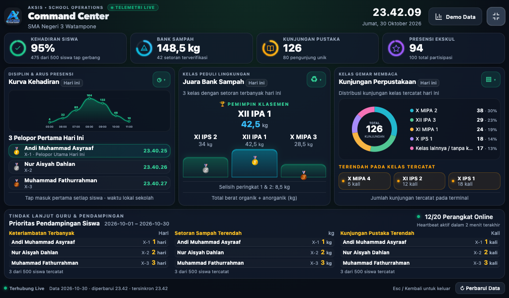
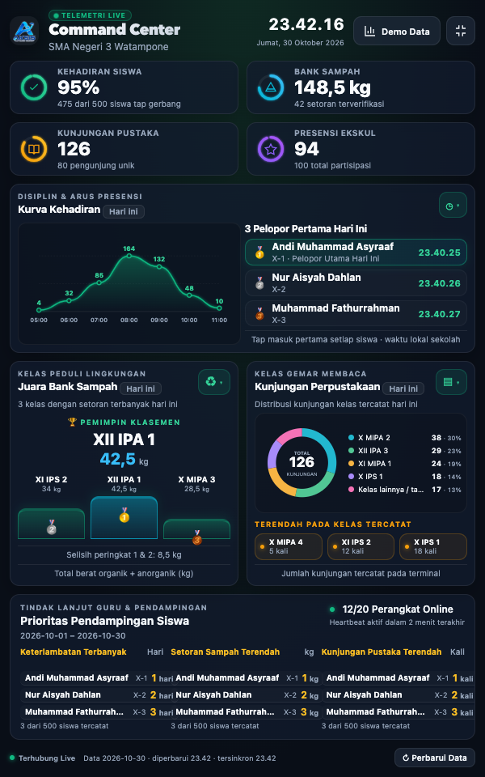
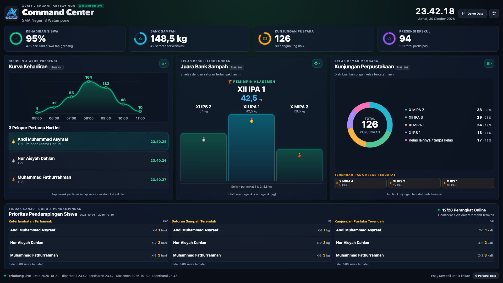

# Laporan Perbaikan Command Center untuk Tablet

Tanggal: 30 Oktober 2026 (WITA).  
Acuan kode: `8d087af`, setelah dua perubahan responsive terdahulu.  
Lingkup: Command Center pada halaman Ringkasan **admin-web**, sesuai gambar pengguna. Perbaikan paket keamanan sebelumnya dipertahankan.

## 1. Hasil

Tata letak fullscreen kini membagi tinggi viewport secara eksplisit. Grafik, podium, legenda perpustakaan, daftar kedatangan, dan pendampingan mengisi area yang disediakan tanpa menyembunyikan baris ketiga. Tata letak landscape dan portrait berbeda agar lebar sempit tidak memampatkan seluruh panel menjadi tiga kolom.

Diagram perpustakaan tidak lagi menggunakan callout SVG yang meluber ke judul. Nama kelas dan persentase ditampilkan pada legenda HTML tersendiri. Semua data contoh kini memerlukan pemilihan mode Demo dan memiliki label berbeda dari data langsung.

Status: diimplementasikan dan diverifikasi lokal; **belum dipublikasikan**. Tidak ada migrasi database untuk perubahan ini.

## 2. Analisis gambar dan penyebab

| Masalah | Penyebab pada implementasi sebelumnya | Perubahan |
| --- | --- | --- |
| Grafik kehadiran sangat pipih | Media query layar pendek memaksa tinggi SVG 26 px, lalu 18 px | Tinggi area grafik menjadi bagian grid panel; rasio SVG dipertahankan |
| Donut dan label menimpa judul | Wadah dibatasi sampai 48 px sementara wrapper/SVG dan callout tetap memiliki ukuran intrinsik lebih besar; overflow SVG terlihat | Donut dibatasi pada viewBox 160×160; legenda ditempatkan di luar SVG dan tetap di dalam panel |
| Panel tinggi dengan ruang kosong besar | Panel utama memakai sisa ruang fleksibel, sementara grafik dan podium memiliki tinggi kecil tetap | Ruang panel dialokasikan ke kurva, daftar dan podium; track podium mengisi area yang tersisa |
| Tiga pelopor hanya tampil dua | `nth-child(n+3)` disembunyikan pada tinggi rendah | Ketiga baris tetap dirender dan terlihat |
| Baris pendampingan menghilang | Media query menyisakan satu atau dua baris tanpa menyesuaikan keterangan jumlah | Tiga baris per kategori tetap terlihat; nama, kelas dan unit dirapikan menjadi satu baris |
| Isi grid meluber meski panel luar pas | Grid implisit dan minimum intrinsik anak mempertahankan lebar/tinggi lebih besar dari track | Track anak memakai `minmax(0, 1fr)`, minimum ukuran diatur, dan batas anak diuji |
| Viewport lama tidak konsisten | Bergantung pada tinggi viewport CSS dan override berlapis | Ukuran viewport diukur dengan fallback API browser lama dan diperbarui saat resize/orientasi |
| Angka contoh berlabel live | Metrik/klasemen kosong otomatis diganti demo; kurva selalu memakai demo | Hilangkan fallback demo otomatis; tampilkan nol/kosong/error secara eksplisit |
| Filter tampak mengubah periode data langsung | Pilihan periode mengubah label dan data demo tanpa mengambil periode nyata dari backend | Filter nonharian dinonaktifkan pada mode langsung dan dijelaskan sebagai fitur demo |
| Ukuran ringkas kurang konsisten | Angka diulang di tengah ring dan di kartu; unit berat tanpa pemisah | Ring berisi ikon, angka utama tunggal, berat mengikuti format Indonesia dengan spasi unit |

## 3. Implementasi

### Tata letak dan fullscreen

`apps/admin-web/src/dashboard/command-center.css` menggunakan lima baris: header, KPI, kompetisi, pendampingan, dan footer. Aturan lama yang menyembunyikan baris data pada layar pendek dihapus.

Tablet landscape tetap menampilkan tiga panel sejajar. Tablet portrait menampilkan kehadiran sebagai panel lebar, lalu dua panel di bawahnya. KPI menjadi dua kolom pada portrait 600–700 px. Lebar di bawah 600 px memakai scroll vertikal sebagai kompromi keterbacaan ponsel.

`command-center.ts` mengukur `visualViewport` atau `innerWidth`/`innerHeight`, memperbarui ukuran ketika layar berubah, dan membersihkan pengaturan saat keluar. Fokus keyboard menjangkau seluruh tombol aktif. Filter memiliki state `aria-expanded`; Esc menutup filter sebelum keluar mode TV.

### Diagram dan data

Modul baru `library-chart.ts` memisahkan rendering diagram perpustakaan dari controller dashboard. Legenda menampilkan empat kelas utama dan kategori lainnya/tanpa kelas bila diperlukan. Input nama kelas di-escape; total segmen tetap mencakup sisa kelas.

Pada backend, `dashboard-rankings.ts` menambahkan `hourly`, dihitung dari CHECK_IN pertama per siswa pada hari sekolah. Event hari lain, event masa depan, dan tap ulang tidak menambah hitungan. Daftar kelas perpustakaan tidak lagi dipotong ke tiga kelas sebelum dibuat distribusi; podium sampah tetap tiga teratas. Kontrak ini bersifat tambahan bagi client lama.

Data live kosong tidak menampilkan contoh. Header, status footer, dan badge membedakan live, tertunda, terputus, serta demo. Saat meninggalkan demo, snapshot contoh dibersihkan sebelum pengambilan data live. Kegagalan pembacaan perangkat juga ditandai dengan benar. Jumlah online/total diambil dari `/devices/summary`, bukan dihitung dari lima perangkat sampel. Keterangan heartbeat diselaraskan dengan jendela dua menit pada endpoint tersebut.

### Berkas utama

- `apps/admin-web/src/dashboard/command-center.css`
- `apps/admin-web/src/dashboard/command-center.ts`
- `apps/admin-web/src/dashboard/library-chart.ts`
- `apps/admin-web/src/dashboard/library-chart.test.ts`
- `apps/api/src/lib/dashboard-rankings.ts`
- `apps/api/src/lib/dashboard-rankings.test.ts`
- `tooling/test-command-center.mjs`
- `package.json` — perintah `test:browser:command`
- `docs/COMMAND_CENTER_TV.md`

## 4. Verifikasi

Tes browser memakai modul dashboard sebenarnya melalui Vite, CSS admin sebenarnya, Chrome headless, dan respons API fixture. Tes tidak masuk ke akun nyata atau meminta data produksi.

| Viewport CSS | Hasil |
| --- | --- |
| 800×480 | Lulus: mode landscape sangat ringkas |
| 800×600 | Lulus |
| 1024×600 | Lulus: sasaran tablet resolusi rendah |
| 1095×618 | Lulus |
| 1280×720 | Lulus |
| 1024×768 | Lulus |
| 1366×768 | Lulus |
| 768×1024 | Lulus: portrait |
| 600×960 | Lulus: portrait sempit |
| 1920×1080 | Lulus: desktop/TV |
| 2190×1236 | Lulus: dimensi lampiran pengguna |

Pemeriksaan otomatis meliputi ukuran root tepat terhadap viewport, panel tidak meluber, baris pendampingan tidak terpotong, tiga kedatangan dan sembilan baris pendampingan terlihat, donut berada di bawah heading dan dalam wadahnya, serta tinggi kurva minimum. Pemeriksaan visual screenshot turut menemukan dan menyelesaikan masalah grid intrinsik pada portrait.

Interaksi yang lulus: filter, fokus Tab, mode demo eksplisit, live dengan nilai nol, kegagalan API, Escape, keluar fullscreen, fullscreen native, fallback tanpa Fullscreen API, dan fallback ketika `visualViewport` tidak tersedia. Dashboard biasa pada lebar 390 px juga diuji terhadap overflow horizontal.

Tes unit dan endpoint terkait: **18 tes pada empat berkas lulus**, mencakup zona sekolah, tap pertama, pagination, permission, data kosong, distribusi kelas lengkap, dan escaping legenda. Pemeriksaan TypeScript admin/API dan build admin **lulus (exit 0)**; hasil final disimpan di folder bukti.

Bukti: [hasil browser](analysis/2026-10-30/command-center-tablet/browser-results.txt), [geometri viewport](analysis/2026-10-30/command-center-tablet/geometry.json), [fullscreen](analysis/2026-10-30/command-center-tablet/fullscreen.json), [hasil unit](analysis/2026-10-30/command-center-tablet/unit-results.txt).

## 5. Pratinjau

Tablet landscape 1024×600:

Tablet portrait 600×960:

Desktop/TV 1920×1080:

## 6. Penerapan dan batas verifikasi

Build API dan admin perlu diterapkan bersama agar kurva live mendapat field `hourly`. Tanpa backend terbaru, client menampilkan pesan bahwa kurva belum tersedia; client tidak membuat kurva contoh untuk menggantikannya. Tidak diperlukan migrasi data.

Uji ini memverifikasi emulasi ukuran layar pada Chrome desktop, bukan firmware/browser tablet fisik. Bilah browser, skala font sistem, dan dukungan fullscreen pada perangkat nyata dapat berbeda. Jika native fullscreen ditolak, dashboard memenuhi area halaman yang tersedia. Konfigurasi mode kiosk/browser perangkat tetap mengendalikan bilah sistem.

Ponsel di bawah 600 px sengaja diizinkan scroll; sasaran satu layar tablet diverifikasi mulai 600 px portrait dan 800×480 landscape. Pada tahap uji lokal tidak dilakukan publikasi situs atau perubahan konfigurasi perangkat fisik.

## 7. Deployment produksi 31 Oktober 2026

Perbaikan ini disertakan kembali pada deployment produksi `dpl_D9wXcA1mRHX5dJWhiccS1hn6oq2R`, READY pukul 08.57 WITA di https://www.aksis.co.id. Pemeriksaan aset produksi membuktikan marker viewport, legenda perpustakaan, podium dan status data sudah termuat. Bukti bersama: `analysis/2026-10-31/parent-portal/production-smoke.json` dan `deployment.json`. Deployment ini sekaligus menerapkan perbaikan Portal Orang Tua; migrasi databasenya dijelaskan pada laporan portal.
