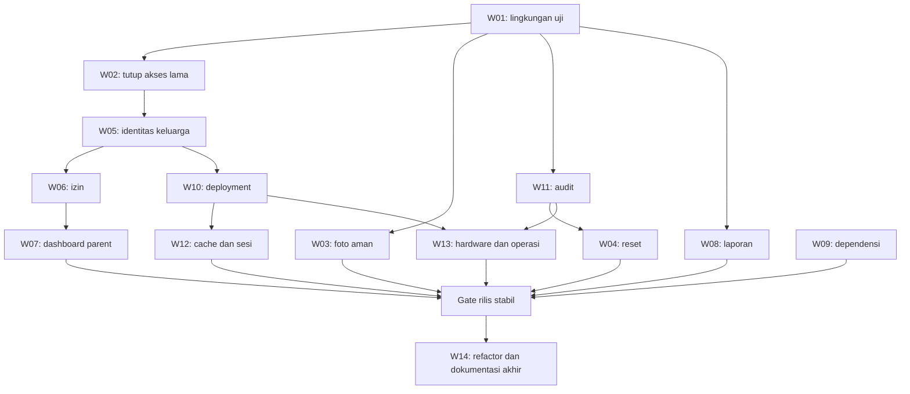

# Rencana Perbaikan AKSIS

Tanggal: 30 Oktober 2026 (WITA)  
Acuan: [Laporan awal analisis](LAPORAN_AWAL_ANALISIS_APLIKASI_2026-10-30.md), commit `8f6b6bf`.  
Status: rencana implementasi; perubahan aplikasi, migrasi remote, dan deployment belum dilakukan.

## 1. Sasaran dan aturan pelaksanaan

Sasaran rencana ini adalah menutup seluruh F01–F14 dengan perubahan yang dapat diuji, ditinjau, dan dirilis bertahap. Urutannya: pulihkan kemampuan membuktikan keamanan database, tutup akses data siswa yang tidak sah, pulihkan integritas fitur, kemudian lengkapi deployment dan operasi.

Setiap paket kerja harus menghasilkan kode/migrasi, tes yang membuktikan masalah tertutup, dokumentasi kontrak yang berubah, dan bukti hasil pemeriksaan. Temuan baru dinyatakan selesai ketika seluruh kriteria penerimaannya terpenuhi; build berhasil saja tidak cukup.

Aturan teknis:

1. Tambahkan migrasi baru setelah urutan terakhir; jangan mengedit migrasi historis yang mungkin sudah diterapkan.
2. Seluruh fungsi `SECURITY DEFINER` wajib memverifikasi caller, scope sekolah/anak, status aktif, dan memiliki grant minimum serta `search_path` tetap. Cabut grant overload lama yang melewati aturan baru.
3. API dan akses Supabase langsung harus tunduk pada invariant akses yang sama. Header browser dan penyembunyian tombol tidak menjadi bukti kewenangan.
4. Gunakan fixture sintetis untuk tes; perubahan produksi mengikuti urutan rilis bagian 8.
5. Jangan menggabungkan refactor besar dengan penutupan celah keamanan. Pertahankan scope PR agar dampaknya dapat ditinjau.
6. Jangan mengembalikan policy rentan saat rollback. Jika jalur baru gagal, tutup fitur terkait dan lakukan perbaikan lanjutan.

## 2. Keputusan desain yang menjadi dasar rencana

Keputusan berikut merupakan usulan teknis operasional untuk implementasi, belum perubahan yang sudah berlaku.

| Area | Keputusan rencana | Alasan dan konsekuensi |
| --- | --- | --- |
| Identitas orang tua | Gunakan akun Auth individual dengan hubungan anak terverifikasi. QR sekolah hanya membuka konteks masuk | Menghapus ketergantungan pada akun sekolah bersama; keluarga perlu login dan verifikasi ulang |
| Hubungan anak | Token undangan acak, sekali pakai, kedaluwarsa, terikat siswa/sekolah, diterbitkan petugas berwenang | NISN dan DOB boleh membantu pencarian oleh petugas, tetapi tidak cukup untuk memberi akses anak |
| Identitas perangkat | `device_id` hanya untuk metadata/UX, bukan batas otorisasi | Mengganti header atau localStorage tidak boleh membuka anak lain |
| Izin siswa | Parent menulis lewat RPC terkendali; status diturunkan server dan aturan domain berlaku di database | Direct table write yang melewati validasi dicabut |
| Foto | Terima JPEG/PNG, decode dan encode ulang; tolak input gagal tanpa menyimpan teks mentah | Semua konsumen memakai URL/data image yang tervalidasi dan DOM aman |
| Laporan | Agregasi SQL dengan scope/periode eksplisit; ekspor lengkap memiliki identitas snapshot/job | Angka tidak boleh tergantung cap respons PostgREST |
| Deployment | Pertahankan lima aplikasi aktif; siapkan empat aplikasi tambahan pada subpath dan aktifkan setelah gate masing-masing | Tidak menyebut modul siap hardware hanya karena frontend tersedia |
| Audit | Simpan event sensitif bersama transaksi bisnis; operasi Auth eksternal memakai operation ledger/outbox | Kegagalan audit dapat direkonsiliasi dan tidak bergantung callback setelah respons |

Akun orang tua dapat menggunakan email/password dengan pemulihan email terverifikasi sebagai alur awal; OTP tidak menjadi dependensi wajib. Pemilihan penyedia email dan alamat pengirim diverifikasi di staging sebelum aktivasi. Undangan tidak boleh menjadi satu-satunya autentikasi berulang.

## 3. Tahapan dan dependensi

Pemilik di bawah adalah fungsi pekerjaan yang perlu ditugaskan, bukan orang yang sudah ditunjuk. Estimasi berupa hari kerja efektif seorang pelaksana yang memahami codebase, termasuk tes lokal tetapi di luar waktu tunggu layanan/perangkat dan review. Estimasi diperbarui setelah fase fondasi.

| Tahap / paket | Temuan | Pemilik utama | Dependensi | Estimasi awal | Hasil yang harus tersedia |
| --- | --- | --- | --- | --- | --- |
| A — W01: fondasi uji DB | F09, F14 | Backend/DB + QA | Tidak ada | 2–3 hari | Migrasi dan tes dapat dijalankan ulang pada DB terisolasi |
| A — W02: pembatasan akses lama | F01, F03, F04 | Backend/DB | W01 untuk pembuktian rilis | 1–2 hari | Jalur akun QR bersama ditolak pada data keluarga |
| A — W03: foto dan HTML | F02 | Backend + frontend | W01/W02 untuk uji akses | 2–4 hari | Payload invalid tertolak dan rendering aman |
| A — W04: reset password | F05 | Backend + frontend | Kerangka audit minimum W11 | 1–2 hari | Target eksplisit, tanpa default password |
| B — W05: identitas keluarga | F01, F04, F12 | Backend/DB + frontend | W01, W02 | 5–8 hari | Login individual, undangan, revalidasi hubungan |
| B — W06: izin siswa | F03 | Backend/DB + frontend | W05 | 2–3 hari | RPC dan constraint konsisten |
| B — W07: ringkasan parent | F06 | Backend/DB + frontend | W05, W06 | 2–3 hari | Kontrak kaya data pulih dan teruji |
| C — W08: laporan lengkap | F07 | Backend/DB + frontend | W01 | 3–5 hari | Agregasi, periode, ekspor dan rekonsiliasi |
| C — W09: dependensi | F08 | Backend/tooling + QA | Inventaris dependency tree | 2–4 hari | Pembaruan teruji dan triase advisory |
| C — W10: deployment | F10 | Frontend + operasi | W05 untuk auth; W13 untuk aktivasi hardware | 2–4 hari | Artefak/routing sembilan aplikasi dan gate aktivasi |
| A–D — W11: audit durable | F11 | Backend/DB + operasi | W01; schema disiapkan sebelum W04/W05 | 3–5 hari | Event sensitif dapat ditelusuri dan direkonsiliasi |
| D — W12: siklus hidup browser | F12 | Frontend + QA | W05, W10 | 2–3 hari | Token/cache/queue terisolasi dan dapat dibersihkan |
| D — W13: hardware dan operasi | F13 | IoT + backend + operasi | W10, W11, akses perangkat staging | 4–8 hari | Uji fisik, provisioning, telemetry dan restore |
| E — W14: pemeliharaan | F14 | Seluruh pemilik domain | Kontrak fitur stabil | 3–5 hari | Modul, dokumentasi dan CI selaras |

Total kasar jika dikerjakan berurutan: **34–59 hari kerja efektif**, bukan janji tanggal selesai. Rilis penutupan awal dapat dilakukan sebelum seluruh fase selesai dengan fitur keluarga lama dinonaktifkan. Pekerjaan independen dapat dijadwalkan bersamaan bila sumber daya tersedia; rencana ini tidak mengasumsikan jumlah anggota tim tertentu.

## 4. Paket kerja keamanan dan identitas

### W01 — Perbaiki fondasi pengujian database (F09)

**Lokasi:** `supabase/tests/auth_stub.sql`, `tooling/test-parent-db-local.sh`, skrip SQL lain, `package.json`, workflow CI baru.

Langkah:

1. Periksa versi PostgreSQL target tanpa membaca data pribadi; pin versi mayor yang sama untuk staging dan CI. Minimum harus mendukung `security_invoker`; jangan menonaktifkan opsi itu agar PostgreSQL 14 lolos.
2. Perbarui auth stub berdasarkan kolom/fungsi Auth yang benar-benar dirujuk migrasi, termasuk `last_sign_in_at`. Stub hanya untuk logika SQL; tes Supabase lokal/staging tetap diperlukan untuk perilaku Auth/PostgREST nyata.
3. Buat runner satu pintu untuk seluruh migrasi dan suite parent, portal, super-admin, library, waste. Gunakan direktori/port terisolasi, cleanup saat sukses/gagal, dan log nama migrasi yang gagal.
4. Tambahkan skenario database kosong dan upgrade fixture versi lama dengan hubungan parent, kartu, serta transaksi yang sudah ada.
5. Jalankan CI tanpa secret produksi; fixture dan schema database dibuang sesudah suite.

**Selesai jika:** seluruh 73 migrasi historis dan migrasi baru lulus berurutan; seluruh assertion SQL dijalankan; rerun bersih menghasilkan hasil sama. Kegagalan lanjutan setelah perbaikan stub dicatat dan diselesaikan, tidak dianggap otomatis hanya masalah lingkungan.

### W02 — Batasi jalur akun QR bersama sebelum migrasi keluarga (F01, F03, F04)

**Lokasi:** migrasi baru, `routes/parents.ts`, `routes/portal-auth.ts`, parent PWA.

Langkah:

1. Inventaris policy, grant tabel dan seluruh signature RPC yang memberi akses profil, hubungan, aktivitas, foto, izin, dan linking. Sertakan pemanggilan langsung dari Supabase.
2. Tambahkan helper database untuk menolak identitas `portal_access`/akun QR bersama pada data keluarga. Terapkan di policy dan setiap RPC terkait; pengecualian admin sekolah harus berdasarkan permission serta scope yang eksplisit.
3. Cabut direct write parent pada tabel izin dan grant overload RPC yang sudah tidak aman; jangan mencabut hak tabel global bagi admin tanpa menyediakan jalur penggantinya.
4. Tutup sementara login data keluarga lama dengan kode `PARENT_REVERIFICATION_REQUIRED`; UI memberi jalur login/verifikasi ulang. Penolakan wajib berasal dari database juga, bukan feature flag UI saja.
5. Tinjau kredensial pada berkas akun akses secara privat. Jika aktif, rotasi sebelum akses diperluas, cabut sesi bila relevan, lalu hapus plaintext dari working tree. Pembersihan riwayat Git memerlukan rencana tersendiri karena mengubah riwayat bersama.

**Selesai jika:** dua pengguna yang memegang QR sekolah sama tidak bisa membaca/mengubah data keluarga melalui API, tabel langsung maupun RPC lama; admin yang berwenang tetap dapat bekerja. Penutupan ini belum menutup F01 secara final sebelum W05 selesai.

### W03 — Amankan foto, rendering dan durasi proses (F02)

**Lokasi:** `schemas/parent.ts`, `routes/parents.ts`, `services/photo-processor.ts`, `library-terminal/src/main.ts`, konsumen foto lain, konfigurasi header frontend.

Langkah:

1. Verifikasi kewenangan anak sebelum decode atau pemanggilan provider; verifikasi ulang saat commit hasil agar pencabutan di tengah proses berlaku.
2. Tambahkan schema unggahan. Batas awal usulan: file decoded ≤5 MiB, JPEG/PNG saja, ≤20 megapixel; tolak SVG, URL remote, base64 cacat, MIME yang berbeda dari isi, dan gambar tak dapat didecode. Selaraskan limit request dan pesan error dengan overhead base64 serta batas hosting yang diverifikasi.
3. Encode ulang menjadi JPEG 900×1200 seperti keluaran sekarang, hapus metadata, dan hanya simpan hasil yang berhasil didecode. Jika provider gagal, fallback hanya ke pemrosesan native yang valid; jika native gagal, kembalikan error, bukan input asli.
4. Tetapkan anggaran keseluruhan proses ≤40 detik dan timeout tiap provider berdasarkan sisa anggaran. Jika batas ukuran/durasi hosting tidak mencukupi, gunakan upload privat langsung dan job; jangan menaikkan timeout tanpa batas.
5. Ganti penyisipan foto lewat `innerHTML` dengan elemen `img` dan assignment properti `src` setelah validasi scheme/origin/data MIME. Audit semua sink foto, termasuk cache lama dan template kartu.
6. Tambahkan CSP pada respons statis setelah uji mode report-only; jangan menganggap Helmet API melindungi frontend. CSP menjadi lapisan tambahan terhadap rendering DOM yang sudah aman.
7. Inventaris foto lama, validasi ulang, karantina referensi invalid, tampilkan inisial pengganti. Jangan memusnahkan foto massal tanpa daftar dan cadangan.

**Tes wajib:** payload markup pada foto tersimpan dan cache tidak membentuk elemen/event baru; corrupted image, MIME palsu, pixel berlebih, provider timeout, pencabutan saat proses, dan foto valid. Verifikasi hasil tidak membawa metadata asli.

**Selesai jika:** tidak ada jalur input mentah ke foto tersimpan; tes browser injeksi lulus; request tanpa hubungan ditolak sebelum pekerjaan mahal; foto valid tetap tampil dan dapat dicetak.

### W04 — Perbaiki reset password (F05)

**Lokasi:** `routes/platform.ts`, UI platform admin, schema reset, operation ledger W11.

Langkah:

1. Hapus default password dan fallback seluruh anggota sekolah. Endpoint sekolah hanya mengembalikan kandidat admin aktif; operasi reset menargetkan satu user ID yang ditampilkan operator.
2. Gunakan recovery email ke alamat akun yang terverifikasi dengan redirect allowlist; respons hanya menyatakan penerimaan operasi, tanpa password/token pemulihan.
3. Jika email akun tidak valid atau tidak terverifikasi, tampilkan status perlu pemulihan akun; jangan otomatis memakai password tetap. Sediakan prosedur verifikasi identitas operator sebelum mengganti alamat kontak.
4. Bedakan query gagal dari kandidat kosong; gunakan error terstruktur. Catat operation ID, actor, target, alasan dan hasil provider tanpa secret. Cegah pengiriman berulang dengan rate limit/cooldown serta idempotensi operasi.
5. Uji invalidasi sesi pascapemulihan pada penyedia Auth; dokumentasikan perilaku aktual dan mekanisme pencabutan tambahan jika dibutuhkan.

**Selesai jika:** role mapping rusak menghasilkan penolakan; anggota lain tidak berubah; password tidak muncul di respons/log; recovery link sah bekerja sekali sesuai lifecycle provider dan dapat ditelusuri audit.

### W05 — Ganti identitas keluarga dan linking (F01, F04)

**Lokasi:** parent PWA; `routes/auth.ts`, `routes/parents.ts`, `routes/portal-auth.ts`; `schemas/parent.ts`; `parent_profiles`, `parent_student_links`, `parent_link_tokens`; seluruh parent RPC/policy.

Langkah:

1. Tambahkan login individual untuk parent. Akun individual tidak memperoleh akses siswa hanya karena dapat login. QR sekolah hanya mengisi konteks sekolah, tidak menghasilkan kewenangan keluarga bersama.
2. Buat helper `can_access_parent_child(student_id)` yang mensyaratkan user terautentikasi individual, hubungan `ACTIVE`, siswa aktif, sekolah aktif dan pasangan sekolah-siswa benar. User ID selalu berasal dari `auth.uid()`, bukan parameter caller.
3. Jadikan helper tersebut invariant untuk daftar anak, today, foto, izin dan profil terkait. Parent dapat memiliki anak lintas sekolah, tetapi setiap hubungan memerlukan undangan sekolah anak itu.
4. Perbarui penerbitan/claim undangan: secret acak 256 bit, hash saja di DB, masa berlaku awal 24 jam, single-use, lock transaksi dan penandaan used dalam transaksi yang sama dengan pembuatan hubungan. Token tidak boleh tampil pada daftar/log.
5. Perbaiki fungsi `claim_parent_link` lama: target `ON CONFLICT` tidak boleh diasumsikan masih cocok dengan index yang telah berubah. Buat unique constraint sesuai model baru `(school_id, parent_user_id, student_id)` setelah penanganan duplikat.
6. NISN dan nomor lokal dipisahkan secara eksplisit untuk pencarian admin. Nomor lokal wajib scope sekolah; hasil ambigu ditolak. DOB tidak memberi akses dan tidak dipakai memilih baris pertama.
7. Tambahkan pembatasan claim gagal di DB atau layanan trusted yang tidak dapat dilewati direct RPC. Batas awal: 5 kegagalan/15 menit per user, dilengkapi pembatasan IP di edge; error tidak mengungkap identitas anak.
8. Perbarui UI profil, login, expired invite, revoked relationship, cross-school child switcher, logout dan login ulang di dua perangkat. `device_id` tetap dapat dikirim untuk diagnostik, tanpa efek pada authorization.

**Migrasi data:** tambahkan penanda sumber/verifikasi hubungan; tandai hubungan milik akun QR sebagai perlu verifikasi ulang. Jangan menggabungkan keluarga berdasarkan DOB, nama, atau device ID. Hubungan individual lama hanya dipertahankan jika provenance verifikasinya dapat dibuktikan. Duplikat dikarantina/direkonsiliasi sebelum unique constraint divalidasi. Riwayat izin/audit tetap mempertahankan actor historis.

**Selesai jika:** parent A tidak dapat mengakses anak B melalui semua jalur, walau memakai sekolah/QR sama, mengetahui UUID anak dan mengganti header; dua orang tua sah dapat mengakses anak sama dengan akun berbeda; undangan paralel hanya dikonsumsi sekali; pencabutan hubungan berlaku pada JWT yang masih aktif.

### W06 — Kunci izin siswa pada aturan database (F03)

**Lokasi:** `student_absence_permits`, RPC `submit_student_absence_permit`, schema/API dan modal izin parent.

Langkah:

1. Cabut write tabel dari parent; pertahankan baca terbatas dan alur admin sesuai permission. Parent mengirim lewat RPC yang memanggil helper W05. Periksa grants default agar tabel baru tidak otomatis terbuka.
2. Tambahkan foreign key komposit `(school_id, student_id)` ke pasangan unik siswa; gunakan preflight dan validasi bertahap untuk data lama yang tidak konsisten.
3. Parse tanggal secara ketat; gunakan timezone sekolah. Batas awal pengajuan: hari ini sampai 7 hari ke depan, tanpa backdate dari parent; admin berizin dapat mengoreksi histori melalui jalur teraudit.
4. Pertahankan perilaku auto-approve saat ini sebagai aturan eksplisit server; client tidak dapat menentukan status/actor/sekolah. Perubahan ke alur persetujuan manual menjadi perubahan produk terpisah.
5. Hitung sakit berurutan di database dan wajibkan referensi lampiran privat yang valid mulai hari kedua. Validasi kepemilikan object, tipe/ukuran dan keberadaannya; panjang string URL tidak cukup.
6. Tangani perubahan tanggal/alasan yang memengaruhi hitungan hari setelahnya secara transaksional dengan lock per siswa. Batasi ukuran rangkaian tanggal yang dihitung ulang.
7. Pisahkan submit izin dari refresh dashboard yang memerlukan `dashboard.read`: izin sah tidak boleh gagal karena parent tidak punya permission dashboard. Gunakan invalidation/event dalam transaksi yang sama.

**Selesai jika:** direct insert/update/delete parent ditolak; sekolah salah, hubungan dicabut, tanggal invalid dan lampiran tidak sah ditolak; retry tidak menggandakan izin; rangkaian sakit tetap benar ketika izin hari sebelumnya diedit.

## 5. Paket kerja integritas fitur dan rilis

### W07 — Pulihkan kontrak dashboard orang tua (F06)

**Lokasi:** RPC today, `apps/parent-pwa/src/main.ts`, shared types, `docs/openapi.yaml`, tes SQL/browser.

Langkah:

1. Definisikan kontrak kanonik berisi `student_id`, `timezone`, `as_of`, `profile`, `attendance`, `waste`, `library`, `extracurricular`, `events`, dan versi kontrak. Gunakan struktur frontend saat ini sebagai dasar tanpa menghilangkan pemeriksaan W05.
2. Definisikan `null` untuk tidak diketahui/tidak tersedia dan `0` untuk jumlah terverifikasi nol. Poin berasal dari transaksi, tidak dikonversi dari kg secara asumtif.
3. Tetapkan batas hari/bulan berdasarkan sekolah; hadir/terlambat/izin/sakit/belum hadir, sesi ekskul batal/masa depan, dan siswa nonaktif harus berbeda.
4. Tambahkan kontrak baru sebagai fungsi bernama/signature jelas; setelah API beralih, cabut overload lama yang tidak aman. Hindari overload ambigu pada PostgREST.
5. Jalankan tes frontend terhadap payload yang benar-benar dihasilkan database hasil seluruh migrasi, selain fixture UI.

**Selesai jika:** seluruh kartu dashboard memiliki sumber data/definisi yang jelas; poin dan kunjungan bulanan akurat; izin muncul konsisten; kasus dua timezone dan pergantian bulan lulus; W05 tetap menolak anak lain.

### W08 — Benahi agregasi dan ekspor (F07)

**Lokasi:** `routes/reporting.ts`, `routes/library.ts`, report schemas, admin report UI, fungsi agregasi SQL baru.

Langkah:

1. Tulis kamus metrik: `attendance_taps` berbeda dari `attendance_days`; `attendance_days` dihitung distinct siswa + tanggal sekolah untuk CHECK_IN. Jangan mengganti arti field lama diam-diam; versioning/rename dan UI label dilakukan bersama.
2. Semua ringkasan memiliki periode `[from, to)` dalam timezone sekolah dan tahun ajaran eksplisit/default aktif. Denominator ekskul hanya sesi yang telah berlangsung, tidak batal, selama keanggotaan aktif dalam periode.
3. Pindahkan agregasi ke SQL scoped sekolah/permission. Hilangkan penggunaan satu halaman query sebagai total. Tangani semua error sumber; jangan ubah kegagalan menjadi angka nol.
4. Tambahkan index setelah `EXPLAIN` pada fixture berskala; targetkan filter school/time/class/student sesuai query final.
5. Hapus ekspor dengan truncation diam-diam. Gunakan export job yang mematerialisasi dataset sesuai cutoff ke snapshot, kemudian menulis CSV dari seluruh halaman snapshot. Beri manifest `row_count`, filter, `as_of`, status dan checksum; unduhan privat dan kedaluwarsa.
6. File terlalu besar diproses asynchronous; UI menampilkan status job dan kegagalan. Kutip CSV dengan benar serta netralkan formula pada field teks yang berawalan karakter formula spreadsheet.

**Selesai jika:** fixture 25.001 transaksi dengan cap respons 100 menghasilkan jumlah dan total sama dengan SQL sumber; ekspor tepat 25.001 baris data, tanpa duplikat/hilang saat transaksi baru masuk; query gagal tampil sebagai error; izin akses ekspor diperiksa saat pembuatan dan pengunduhan.

### W09 — Triase dan perbarui dependensi (F08)

**Lokasi:** `package.json`, lockfile, modul foto, import spreadsheet, build/test tooling, evidence audit.

Langkah:

1. Simpan dependency tree runtime/dev dan periksa kembali advisory saat implementasi. Audit awal 11 paket adalah baseline tanggal 30 Oktober, bukan daftar versi target permanen.
2. Prioritaskan dependency pada input tak terpercaya: foto, parser HTTP, schema dan spreadsheet. Perbarui per kelompok dengan lockfile terkontrol; jangan memakai `--force` massal.
3. Evaluasi pengganti/distribusi terpelihara untuk `xlsx`, berdasarkan sumber resmi dan kebutuhan Dapodik. Buat fixture `.xlsx`, `.xls`, CSV, header Indonesia, tanggal Excel, angka/NISN dengan nol di depan dan sel formula. Hentikan format yang belum aman melalui pesan UI yang eksplisit bila pengganti belum mendukungnya.
4. Perbarui Vitest/Vite beserta transitive dependencies dalam PR tooling terpisah; uji Node runtime target, konfigurasi bundling, runner dan service worker.
5. Jalankan audit penuh dan runtime-only; catat reachability, kondisi eksploitasi, versi perbaikan dan alasan jika advisory belum ditutup.

**Selesai jika:** tidak ada critical/high yang relevan dan belum ditangani pada jalur terpapar; advisory tersisa memiliki mitigasi teruji, pemilik, dan tanggal kedaluwarsa pengecualian. Seluruh tes/build serta fixture impor/foto lulus. Jumlah advisory nol saja tidak menggantikan tes perilaku.

### W10 — Lengkapi deployment dan akses aplikasi tambahan (F10)

**Lokasi:** `package.json`, `vercel.json`, Vite config, manifest/service worker, command/LED/card-writer/operations UI.

Langkah:

1. Tetapkan subpath `/command/`, `/led/`, `/card-writer/`, `/operations/`; tambahkan base Vite, output copy, rewrite tepat dan scope service worker masing-masing. Pastikan aset tidak tertangkap fallback admin.
2. Tambahkan `typecheck:all`, `build:all`, `test:db:all` dan `verify` yang mencakup API + sembilan frontend. Dokumentasikan perbedaan build artefak dengan aktivasi fitur.
3. Tambahkan login/tenant selection yang sah untuk command/operations dan pairing berumur pendek untuk perangkat/station; pengguna tidak perlu menempel token melalui DevTools.
4. Sediakan tampilan unauthorized, disconnected, revoked, empty dan error. Modul hardware dinonaktifkan sampai W13 lulus, meski artefaknya sudah tersedia.
5. Periksa header statis, CSP W03, direct refresh URL, manifest start_url/icons, install/update/offline shell di setiap subpath.

**Selesai jika:** smoke test otomatis membuka sembilan entrypoint dan deep link tanpa 404/fallback salah; service worker tidak mengendalikan portal lain; login/pairing dan pencabutan berhasil pada preview staging.

### W11 — Jadikan audit sensitif tahan kegagalan (F11)

**Lokasi:** `middleware/audit.ts`, rute platform/parent/production/device, RPC bisnis, tabel audit dan operation ledger/outbox.

Langkah:

1. Buat matriks aksi wajib: linking/revoke, foto, izin, IAM, provisioning sekolah, reset, credential rotation, aksi batch/write kartu, ekspor dan perubahan perangkat.
2. Aksi SQL menulis audit dalam transaksi bisnis yang sama; kegagalan audit menggagalkan aksi sensitif. Payload mencakup actor, sekolah target, resource ID, action, request/operation ID, hasil dan perubahan field yang diizinkan.
3. Aksi Supabase Auth eksternal memakai state `PENDING/SUCCEEDED/FAILED/UNKNOWN`; tulis intent sebelum call dan rekonsiliasi hasil ambigu. Idempotensi mencegah pengulangan berbahaya, bukan sekadar membungkam duplikat log.
4. Hilangkan ketergantungan pada `res.finish` untuk pencatatan wajib; tentukan satu pemilik event agar middleware dan RPC tidak menggandakan audit.
5. Redact token, recovery link, password, secret kartu/perangkat, DOB dan payload foto dari log. Percobaan akses gagal dicatat secara minimum dengan limit agar tidak menjadi sumber kebocoran/DoS.

**Selesai jika:** setiap aksi matriks punya event yang dapat dicari melalui operation ID; pemutusan proses setelah respons tidak menghilangkan audit wajib; kegagalan provider dan retry dapat direkonsiliasi; tes memastikan secret tidak masuk log.

## 6. Paket kerja ketahanan dan pemeliharaan

### W12 — Atur sesi, cache, dan antrean browser (F12)

**Lokasi:** `apps/shared/portal-session.ts`, library queue/cache, command snapshot, admin session, logout/pencabutan semua portal.

Langkah:

1. Tetapkan namespace `user + school + portal + schemaVersion` pada seluruh data lokal. Snapshot command harus scope sekolah dan hanya dirender setelah konteks cocok.
2. Untuk browser portal, rancang sesi backend dengan cookie HttpOnly/Secure/SameSite dan CSRF protection pada write; backend hanya meneruskan JWT user agar RLS tetap berlaku. Buat refresh-token rotation terkoordinasi lintas tab dan cookie/path yang tidak saling menimpa. Portal staf tetap memerlukan konteks yang disahkan server.
3. Migrasikan sesi localStorage melalui login ulang dan hapus token lama. Hilangnya cookie/storage tidak boleh mengembalikan sesi lama secara diam-diam.
4. Cache identitas library hanya field minimum, tanpa foto persisten secara default; TTL awal 24 jam. Logout/revoke membersihkan identitas dan snapshot konteks terkait.
5. Queue offline tetap terpisah dari cache: jangan hapus event belum terkirim diam-diam. Saat logout dengan queue tertunda, upayakan sync; jika gagal, simpan terkunci pada principal lama dan beri status jelas. Login principal lain tidak boleh melihat/mengirim queue tersebut.
6. Tambahkan state `PENDING/SYNCING/SYNCED/FAILED`, retry dengan backoff dan penanganan event yang ditolak permanen agar satu event buruk tidak memblokir seluruh antrean.

**Selesai jika:** dua akun/sekolah bergantian pada satu browser tidak melihat cache/queue lain; logout dan revoke efektif; refresh lintas tab tidak merusak sesi; queue bertahan setelah reload dan mengirim event yang sama tepat sekali secara bisnis.

### W13 — Buktikan hardware dan kesiapan operasi (F13)

**Lokasi:** adapter LED/card writer, provisioning perangkat, `lib/metrics.ts`, rate limiter/proxy, runbook operasi.

Langkah:

1. Pisahkan adapter simulator dari adapter produksi. Implementasikan protokol Huidu berdasarkan model/controller yang benar-benar dipakai; adapter DOM diberi status simulator.
2. Heartbeat melaporkan kondisi hasil pemeriksaan nyata dengan `checked_at`; gunakan `UNKNOWN` bila tidak dapat memastikan kondisi controller. ACK sukses hanya setelah konfirmasi hardware, bukan setelah DOM berubah.
3. Jalankan card writer dengan firmware acuan: read UID → write expected UID → read-back → verify → acknowledge. Uji cabut serial, timeout, kartu berbeda, lease habis, retry dan job bersamaan.
4. Tambahkan pairing sekali pakai dengan TTL, otorisasi admin, rotasi dan revoke credential. Secret tidak masuk bundle/log dan perangkat tidak membawa service-role.
5. Kirim telemetry ke penyimpanan agregat di luar proses; gunakan histogram/counter yang sesuai multi-instance. Terapkan limiter terdistribusi/edge dan konfigurasi trusted proxy yang spesifik, bukan mempercayai seluruh header forwarding.
6. Uji beban fixture pada 2× puncak yang diukur, minimum skenario dua sekolah serentak; ukur API p95 <500 ms, kegagalan ingest <1%, dashboard normal <2 menit sesuai target runbook. Angka availability 99,9% harus dibuktikan lewat observasi berjalan, bukan tes singkat.
7. Lakukan restore database terisolasi; verifikasi integritas tenant, audit dan transaksi. Catat RPO ≤15 menit/RTO ≤4 jam atau gap yang harus ditutup. Uji alert 5xx, latency, device silent, backlog dan backup gagal sampai penerima yang ditetapkan.

**Selesai jika:** bukti tes fisik per model tersedia; simulasi tidak mengklaim kondisi hardware; load/alert/restore memiliki log hasil, pemilik dan prosedur pemulihan. F13 belum selesai bila akses perangkat belum tersedia.

### W14 — Rapikan struktur, kontrak dan dokumentasi (F14)

**Lokasi:** `admin-web/src/app.ts`, `parent-pwa/src/main.ts`, modul padat, root tooling, README, OpenAPI, env example dan CI.

Langkah:

1. Pecah frontend berdasarkan domain dan tanggung jawab: API/types, state/session, rendering, event binding. Mulai dari modul yang sudah memiliki regression test; lakukan satu domain per PR.
2. Format modul satu baris dan tambahkan lint/format check tanpa mengubah perilaku. Jangan sekaligus mengganti framework UI.
3. Pindahkan skrip ad hoc yang masih dibutuhkan ke tooling dengan klasifikasi read-only/local/remote/destructive. Karantina skrip lama dari runner otomatis; jangan mengeksekusinya untuk mengetahui efeknya.
4. Selaraskan README, OpenAPI, service-role allowlist, CORS/port, login orang tua, kontrak dashboard, batas upload dan deployment aktual. `.env.example` hanya placeholder dan seluruh env wajib tervalidasi.
5. Tambahkan matriks verifikasi seluruh aplikasi, template bukti rilis, serta pembaruan status temuan. Secret scanner pada perubahan dan riwayat dijalankan tanpa mencetak nilai secret.

**Selesai jika:** developer baru dapat menjalankan aplikasi/tes dari petunjuk bersih; setiap pemakaian service-role punya alasan dan pengujian scope; CI memeriksa seluruh entrypoint; tidak ada kredensial aktif dalam source yang dibagikan.

## 7. Matriks pengujian penerimaan

| ID tes | Skenario wajib | Paket | Bukti minimum |
| --- | --- | --- | --- |
| T01 | Migrasi kosong + upgrade data lama, seluruh suite SQL | W01 | Log migrasi dan assertion, versi PostgreSQL |
| T02 | Dua keluarga, QR sama, UUID diketahui, header perangkat diganti, akses REST/RPC langsung | W02/W05 | Allow/deny per policy/fungsi |
| T03 | Individu tanpa hubungan, hubungan dicabut, siswa/sekolah nonaktif | W05/W06/W07 | Semua read/write ditolak konsisten |
| T04 | Claim undangan paralel, expired/used, role non-parent, NISN ambigu | W05 | Tepat satu claim sah, tanpa bocor identitas |
| T05 | Foto valid/invalid, MIME palsu, ukuran/pixel berlebih, HTML/cache berbahaya, timeout | W03 | API rejection + assertion DOM browser |
| T06 | Direct write izin, sekolah salah, sakit beruntun diedit, lampiran palsu | W06 | Penolakan dan hasil transaksi yang benar |
| T07 | Today lintas zona waktu, batas hari/bulan, izin, poin, sesi batal/masa depan | W07 | Payload DB sama dengan kontrak/UI |
| T08 | 25.001 transaksi, cap 100, concurrent insert, query error, CSV formula | W08 | Rekonsiliasi angka, manifest dan file |
| T09 | Reset satu admin, mapping gagal, provider timeout, ulang operation | W04/W11 | Tidak ada perubahan anggota lain/secret log |
| T10 | Import Dapodik dan foto sesudah pembaruan dependensi | W09 | Fixture lama dan baru tetap benar |
| T11 | Sembilan route/deep link, service worker update dan manifest | W10 | Smoke test preview staging |
| T12 | Logout/revoke, dua akun satu browser, offline queue dan event gagal permanen | W12 | Tidak ada data silang/hilang diam-diam |
| T13 | Audit commit gagal, proses terputus, provider hasil ambigu | W11 | Durable event atau state rekonsiliasi |
| T14 | LED fisik, serial putus, salah kartu, retry dan revoke perangkat | W13 | Log station/controller dan hasil read-back |
| T15 | Multi-instance limiter, beban puncak, alert dan restore | W13 | Metrik, notifikasi uji dan laporan RPO/RTO |

Baseline 150 tes dipertahankan; perubahan perilaku yang disengaja memperbarui assertion dan kontrak secara bersamaan. Tes baru harus membuktikan invariant atau regresi di atas, bukan hanya menyalin detail implementasi. Evidence disimpan per paket dalam `docs/analysis/<tanggal-rilis>/`, tanpa data pribadi atau secret.

## 8. Migrasi, rilis dan rollback

### Rilis R0 — Penutupan akses berisiko

Isi: W01, W02, W03, W04 serta audit minimum W11. Portal keluarga lama menampilkan kebutuhan verifikasi ulang; fungsi lain tetap diuji sesuai scope. Gate: T01, T02 untuk penolakan akun bersama, T05 dan T09 lulus. Jangan menunda penutupan hanya untuk menunggu seluruh fitur akun individual selesai.

### Rilis R1 — Pemulihan portal keluarga yang aman

Isi: W05–W07, audit terkait dan session cleanup minimum. Gate: T02–T07, T12 untuk isolasi keluarga, dan T13 lulus. Jalankan pilot pada sekolah yang disepakati, lalu perluas setelah hasil pilot memenuhi gate. Hubungan lama tidak diaktifkan kembali tanpa verifikasi.

### Rilis R2 — Integritas data dan distribusi aplikasi

Isi: W08–W10 dan kelengkapan W11/W12. Gate: T08–T13 lulus, triase dependensi selesai. Empat modul tambahan tetap memiliki gate aktivasi terpisah sampai hardware/provisioning siap.

### Rilis R3 — Kesiapan operasional dan pemeliharaan

Isi: W13/W14. Gate: T14/T15, runbook, penugasan operasi dan dokumentasi aktual lengkap.

Urutan standar setiap rilis:

1. Catat versi aplikasi, checksum migrasi dan kondisi target; pastikan backup dan restore staging telah diuji.
2. Jalankan preflight: jumlah hubungan duplikat, pasangan sekolah-siswa tidak konsisten, foto invalid, overload/grant lama dan transaksi tertunda. Simpan hitungan anonim, bukan dump publik.
3. Terapkan migrasi **expand** terlebih dahulu: kolom/helper/fungsi baru, constraint belum tervalidasi bila perlu; tidak langsung menghapus data lama.
4. Deploy API/UI kompatibel. Aktifkan aturan baru pada staging dan jalankan suite langsung terhadap Auth/PostgREST nyata.
5. Rekonsiliasi/backfill dalam batch dengan checkpoint; validasi constraint. Untuk penutupan celah, penolakan jalur lama tidak menunggu backfill keluarga.
6. Rilis pilot, pantau error auth/claim/izin/foto, mismatch laporan, queue dan audit. Perluas hanya bila tidak ada akses silang atau kehilangan transaksi dan target operasional terpenuhi.
7. Tahap **contract**: cabut fungsi/grant lama dan hapus compatibility code setelah penggunaan lama nol selama satu siklus rilis yang disepakati. Simpan histori yang diwajibkan.

Rollback:

- Frontend/API dapat kembali ke versi kompatibel dengan schema expand; pin pasangan versi yang telah diuji.
- Kebijakan keamanan baru tetap aktif; kegagalan portal diarahkan ke maintenance/verifikasi ulang, bukan policy lama.
- Migrasi destruktif memakai forward-fix; restore database hanya untuk keadaan pemulihan yang direncanakan karena dapat menghilangkan transaksi setelah titik backup.
- Batch gagal dapat diulang dari checkpoint; sebelum pembatalan rilis, rekonsiliasi side effect Auth, undangan, export job, dan pekerjaan kartu yang sedang berjalan.

## 9. Kriteria penutupan seluruh temuan

| Temuan | Paket penutup | Syarat utama |
| --- | --- | --- |
| F01 | W02 + W05 | Identitas individual dan semua jalur data keluarga terisolasi |
| F02 | W03 | Input foto valid saja, tanpa HTML injection dan fallback mentah |
| F03 | W02 + W06 | Direct write ditutup, RPC dan FK menjaga relasi/aturan izin |
| F04 | W05 | Undangan terverifikasi, role benar, identifier deterministik |
| F05 | W04 + W11 | Recovery satu target, tanpa default secret, audit durable |
| F06 | W07 | Kontrak kaya data terbukti dari migrasi akhir hingga UI |
| F07 | W08 | Total/ekspor lengkap, periode jelas, error tidak menjadi nol |
| F08 | W09 | Risiko advisory ditutup/ditangani dengan bukti dan batas pengecualian |
| F09 | W01 | Seluruh migrasi dan assertion berjalan pada DB target |
| F10 | W10 | Artefak/routing lengkap; aktivasi sesuai gate fitur |
| F11 | W11 | Seluruh aksi sensitif memiliki jejak audit tahan kegagalan |
| F12 | W05 + W12 | Sesi/cache/queue tidak bocor lintas principal dan lifecycle teruji |
| F13 | W13 | Hardware, telemetry, load, alert dan restore terbukti |
| F14 | W01 + W14 | CI, struktur, env, dokumentasi dan pengelolaan skrip selaras |

Setiap PR mencantumkan ID W/F terkait, perubahan kontrak/migrasi, tes penerimaan yang dijalankan, risiko kompatibilitas, dan rollback. Status awal seluruh paket adalah **belum dimulai**. Status berikutnya: `berjalan → siap ditinjau → lulus staging → dirilis → terverifikasi`. Tidak ada paket dianggap selesai hanya karena dokumen rencana ini telah dibuat.
